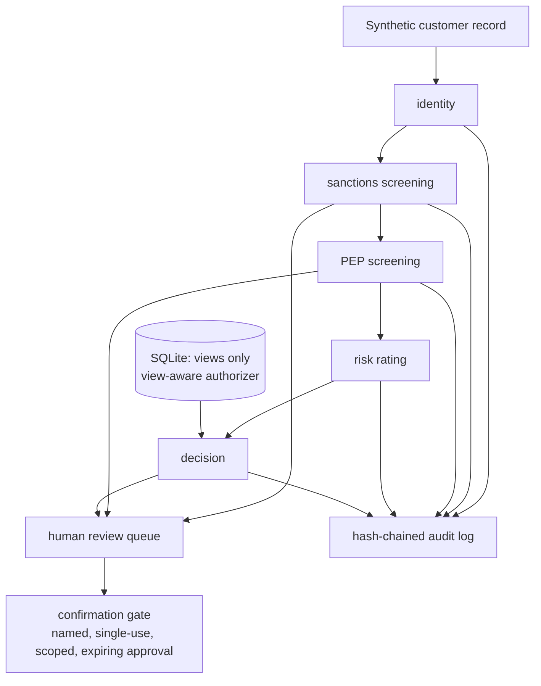

# Architecture

## Module map

| Module | Job |
|---|---|
| `matching.py` | Normalization, de-accenting, spelling variants, fuzzy scoring |
| `chain.py` | Step ordering, re-grounding, drift check, escalation |
| `audit.py` | Hash-chained log + verification |
| `store.py` | View-only SQLite store, fetch-time row cap |
| `redaction.py` | Card / email / SSN / phone redaction for logs and errors |
| `gates.py` | Human-confirmation gate + consent classification |
| `budget.py` | Non-negative cost validation and budget tracking |
| `notify.py` | Dry-run review notices (refused in CI, no credentials) |
| `brand.py` | Hashed blocklist for fictional-brand collision checks |
| `demo.py` | Offline demo over 4 synthetic customers |

Standalone Mermaid sources live in `knowledge/` and are linked from
the README's docs list.
